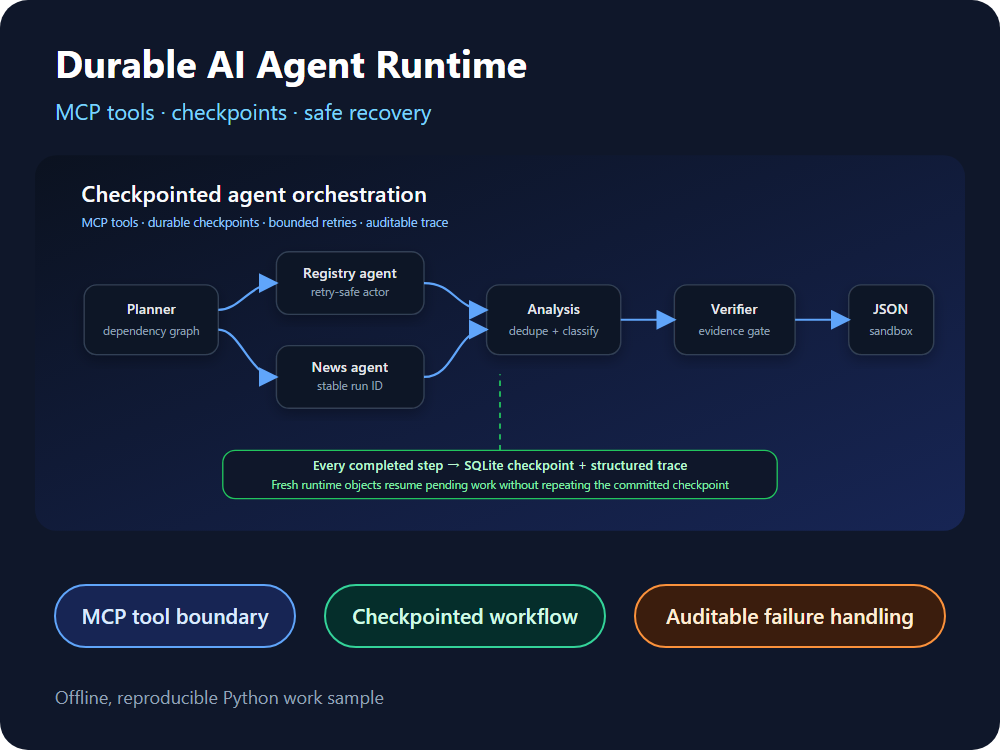

# Durable Multi-Agent Runtime Demo

**A local proof that durable checkpoints let a reconstructed agent runtime continue without
repeating completed work.**

For a client building agent automation, the expensive failures are rarely the happy path. They are
duplicate side effects after a restart, unbounded retries, weak tool boundaries and runs that cannot
be explained afterward. This repository demonstrates concrete controls for those failure modes in a
small, offline system: SQLite checkpoints, stable step identity, bounded retries, schema-checked MCP
tools, a JSON-only output sandbox and structured traces.



The editable cover source is [`docs/assets/portfolio-cover.svg`](docs/assets/portfolio-cover.svg);
its embedded workflow source is [`docs/assets/runtime-flow.svg`](docs/assets/runtime-flow.svg).

## 30-second proof

Python 3.11+ is the only runtime requirement. The demo raises a controlled exception after a
committed checkpoint, closes the first store, constructs fresh runtime/store objects in the same
Python process and finishes the remaining steps:

```bash
python -m pip install -e .
agent-runtime-demo demo
```

The important output is `final_status: completed`, `checkpoint_attempts: 1` and
`artifact_written: true`. The completed collector was not repeated after the simulated interruption.
The command uses a temporary directory and leaves no runtime database or artifact in the repository.

```json
{
  "interrupted_after": "collect_registry",
  "final_status": "completed",
  "checkpoint_attempts": 1,
  "completed_steps": 5,
  "trace_events": 14,
  "artifact_written": true
}
```

## What a client can inspect

- **Recovery semantics:** each successful step is committed before the next one begins; newly
  constructed runtime/store objects resume pending work without rerunning the checkpointed collector.
- **Tool safety:** five MCP tools use allowlisted fixture IDs, enforced input schemas and explicit
  JSON-RPC lifecycle/error boundaries.
- **Failure behavior:** transient actor errors retry with a bound, changed fixture content fails
  closed on resume, and path traversal cannot escape the JSON artifact sandbox.
- **Operational evidence:** ordered traces, step attempts and machine-readable evaluation make each
  claim locally reproducible instead of relying on screenshots or a hosted demo.

## Reproduce all evidence

Install the local development dependencies, run the full suite and regenerate the repository's
reference evaluation report:

```bash
python -m pip install -e ".[dev]"
python -m pytest -q
python -m ruff check .
python -m mypy src tests tools
python -m compileall -q src tests
agent-runtime-demo evaluate fixtures --output reports/evaluation.json
```

For the complete publication gate, including a manifest-only temporary commit, local clone,
offline wheel build and fresh-venv demo, run `python tools/verify_release.py`. It does not modify this
repository's index or history. See [publication-runbook.md](docs/publication-runbook.md).

Run one business fixture directly if you want the complete step and trace payload:

```bash
agent-runtime-demo run fixtures/01-normal.json --output reports/demo-run.json
```

## Try the MCP server

Start the local stdio server with a dedicated database and workspace:

```bash
agent-runtime-demo mcp \
  --fixtures fixtures \
  --database reports/mcp-runtime.sqlite \
  --workspace workspace/mcp
```

An MCP client can then discover and call `list_fixtures`, `start_workflow`, `resume_workflow`,
`get_run_status`, and `get_run_trace`. See [mcp-tools.md](docs/mcp-tools.md) for the protocol surface,
example requests and the explicit security boundary.

## What is directly demonstrated

- Five explicit agent roles with dependency-aware subagent handoffs
- SQLite checkpoints and idempotent step identity across runtime reconstruction
- A controlled exception after a committed checkpoint, followed by fresh-object resume without
  rerunning that step
- An Apify-shaped local actor boundary with stable run IDs and bounded transient retries
- A file sandbox that permits JSON artifacts only and rejects path traversal fail-closed
- Registry/news deduplication, deterministic classification and evidence verification
- Structured traces for run, step, retry, simulated interruption, policy denial and completion events
- Runtime health counts plus stale-lease recovery for a lost worker
- Machine-readable evaluation of normal, transient-failure and sandbox-violation scenarios
- MCP `initialize`, tool discovery and tool-call responses over JSON-RPC stdio
- MCP-controlled interruption and fresh-server-object resume without rerunning a completed checkpoint
- Fixture lookup by allowlisted ID rather than arbitrary paths supplied by a tool caller
- Canonical fixture snapshot and SHA-256 binding, with fail-closed resume after content changes
- Runtime enforcement of each published tool schema, including unknown-property rejection
- Handshake lifecycle, protocol counter-offer, request-ID and JSON-RPC error boundaries, including
  malformed id-less objects versus valid no-response notifications

## Honest evidence boundary

This is a local runtime proof, not a production-deployment claim:

- `LocalActorClient` does not call Apify. It reproduces actor run identity, dataset return and
  transient failure behavior with fixtures.
- SQLite persistence is exercised. Cloudflare D1 compatibility, migration and concurrency are not.
- There is no Next.js operator UI, Cloudflare Worker, external LLM or deployed endpoint.
- The MCP server is a deliberately small stdio implementation tested for protocol version
  `2025-06-18`, JSON-RPC boundaries and its published tool schemas; interoperability with real MCP
  clients and other protocol generations is not claimed.
- Runtime reconstruction and stale-worker recovery are deterministic tests, not a multi-day soak test.
- The interruption test does not terminate an OS subprocess. It raises a controlled exception and
  reconstructs runtime/store objects in the same Python process; real process-death recovery remains
  a production evidence requirement.
- No credential, paid account, client data or external network is used.

These limitations are embedded in both this README and the generated evaluation JSON. See
[architecture.md](docs/architecture.md), [evaluation.md](docs/evaluation.md), and
[deployment-boundary.md](docs/deployment-boundary.md).

## Runtime flow

```text
planner
  ├── registry_collector ─┐
  └── news_collector ─────┤
                          ▼
                    event_analyst
                          ▼
                    evidence_verifier
                          ▼
                    report_publisher ──► JSON-only sandbox

Every transition ──► SQLite checkpoint + structured trace
```

## Failure semantics

| Failure | Runtime behavior | Evidence |
|---|---|---|
| actor temporarily unavailable | retry the same idempotency key, at most 3 attempts | fixture 02 |
| controlled exception after checkpoint | completed step stays completed; fresh runtime/store objects resume | automated test |
| MCP client requests resume | a new server verifies the stored snapshot digest; only pending work executes | automated test |
| fixture changes after interruption | digest mismatch rejects resume before mixed-generation work | automated test |
| worker lease is stale | running step returns to pending with explicit reason | automated test |
| publisher requests `../escape.json` | deny write and fail the run | fixture 03 |
| dependencies cannot progress | fail with `dependency_deadlock` | structured trace |
| tick budget is exhausted | fail with `tick_budget_exhausted` | runtime guard |

## License

[MIT](LICENSE) © 2026 Yusuke Miyajima
